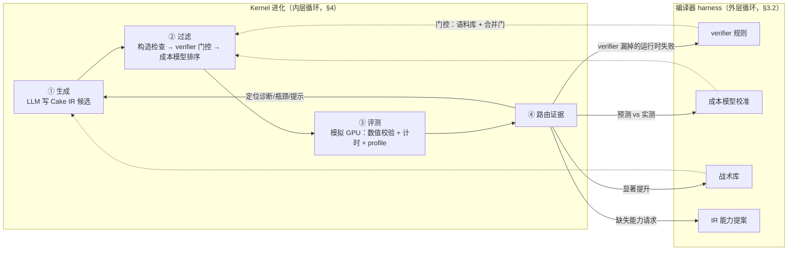
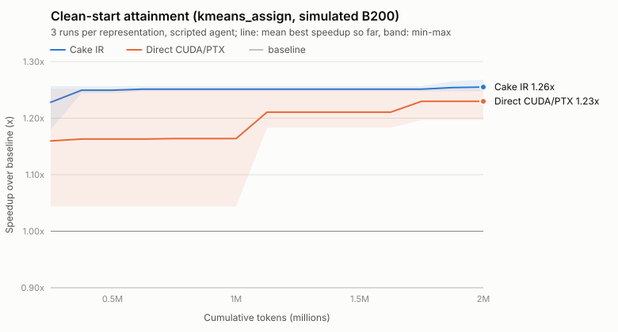

# cake-agent：CAKE 论文 agent 的非官方复现

> 复现论文 **CAKE: Compiler-Agent Co-Design for Frontier Kernel Evolution**（Ye et al., NVIDIA & CMU, arXiv:2608.12629, 2026）中的 kernel 进化 agent 及其编译器 harness。
>
> **重要说明**：这是一个**独立的、非官方**复现。手边没有 B200（甚至没有 NVIDIA GPU），所以执行端是一个自研的**模拟 GPU**（功能级 + 时序级），而不是真实硬件；所有性能数字都来自模拟器，**不能与论文中的 B200 实测数值直接比较**。本仓库复现的是论文的*系统设计与实验方法*，而不是它的硬件结果。

---

## 1. 论文在说什么

现有的 GPU kernel agent 把编译器当作黑盒：环境只返回编译错误、正确与否和端到端耗时——这些信号从不说明*是哪个程序决策*导致了同步失败、硬件契约违规或流水线停顿。Cake 把两者**协同设计**，做了三个承诺：

1. **agent 编辑类型化的 IR 而不是裸 CUDA**：Cake IR 是硬件显式的调度表示（声明资源、warp 角色、barrier、流水线），硬件决策在代码生成前就可检查；地址、相位位、TMEM 偏移、warp 身份等由 lowering 推导。
2. **编译器返回定位到具体位置的诊断，而不是一个 pass/fail 比特**：廉价的静态分析在候选消耗 GPU 时间之前就把它们过滤掉。
3. **harness 本身是进化的对象**：反复出现的失败变成新的 verifier 规则、校准任务、新原语或可复用战术，并由语料库测试门控。

## 2. 复现了什么：论文 → 代码

| 论文中的概念 | 本仓库实现 | 位置 |
|---|---|---|
| Cake IR：类型化、硬件显式的调度（§2.2, 图 3, 附录 B） | Python 内嵌 DSL：`@cake.schedule()`、`lm.smem/view/tmem/role/pipeline/barrier`、`with role:`、`lm.range`、`tma_load/wait/arrive/commit/mma/tmem_load/reduce…`；构造期做局部类型检查（P4），错误定位到源码行 | `cake/ir/` |
| Lowering：schedule 说"做什么"，lowering 推导"怎么做"（§2.2） | 推导 smem 布局、mbarrier 地址、事务组 `expect_tx` 字节数、按角色的相位位掩码、TMEM 列号、MMA 描述符、初始化序言 | `cake/lower.py` |
| 架构覆盖矩阵（表 3），精确目标匹配 | sm_80 / 89 / 90a / 100a / 103a / 120a / 121a 能力表；不支持的目标直接报错而不降级 | `cake/targets.py` |
| 执行硬件（B200） | **模拟 GPU**：事件驱动的功能+时序仿真，建模 mbarrier 相位/奇偶语义、TMA 异步拷贝与 OOB 零填充、tcgen05 MMA 与 TMEM、swizzle、lane 象限、proxy fence、共驻 CTA 争用、占用率/wave、L2/HBM 带宽 | `cake/sim/` |
| 直接 CUDA/PTX 对照组（§5） | `@cake.raw_kernel()` 低层 API：手工管理字节地址、mbarrier 奇偶、tx 字节、TMEM 列、描述符 swizzle、warp 谓词；只返回编译错误/粗粒度运行时错误/正确性/计时 | `cake/lir/` |
| 分析与验证（§3.1, 表 1） | 抽象执行引擎（精确 barrier 语义 + **向量时钟** happens-before 竞争检测、死锁等待环、相位溢出、未初始化读、越界…）+ 规则注册表：程序安全 / 硬件一致性 / 数据一致性 / 调度语义（门控）、性能分析（报告）、优化建议（提示）；明确报告分析覆盖范围（附录 C） | `cake/verify/` |
| 校准的成本模型 + 瓶颈归因（§3.1） | 按角色关键路径 + 单元工作量 + 占用率/wave 的解析模型；只对 B200/H100 有校准，其他目标拒绝预测；Nelder–Mead 拟合系数，留出集门控 | `cake/cost/` |
| Agent 工作流四阶段（§4） | 生成 → 构造检查/verifier 门控/成本模型排序 → 对 oracle 校验 + 计时 + profile → 证据路由（候选/verifier/成本模型/IR 词汇/战术） | `cake/agent/evolve.py` |
| 工作负载契约（§4） | 形状、oracle、容差、硬件、允许的参考资料固定在契约里 | `cake/workloads/` |
| Flash-KMeans assign（§5，B=32,N=65536,K=1024,D=128） | 主工作负载：BF16 GEMM + argmin epilogue，容忍并列的正确性检查；另有 BF16 GEMM | `cake/workloads/` |
| 编译器 harness 进化（§3.2, 图 4） | 失败按 sanitizer 签名聚类 → 规则提案（LLM 合成规则代码 / 离线用规则模板库）→ **三重门控**（命中失败样本、不误报语料库、不误报已通过的候选）+ 合并门；成本模型校准；战术沉淀；IR 能力缺口提案（P1–P8 检查单） | `cake/evolution/` |
| 已验证的 kernel 语料库（§3.2 "test-gated across the kernel corpus"） | KMeans 多种调度（含尾部 shape）、GEMM、论文图 3 片段（静态用例） | `cake/corpus/` |
| 从单 shape 到函数库：泛化与分派（§6） | shape 域预先声明并哈希、确定性 held-out 划分、按 shape 特征分桶、增益门槛才加路由、guard + 显式 fallback、覆盖/重叠/尾部/fallback 校验、Gspan | `cake/dispatch/` |
| LLM | Claude（官方 `anthropic` SDK，默认 `claude-opus-5-5`，effort=xhigh 对应论文设置）、OpenAI 兼容接口（论文用的 GPT 系列，或 DeepSeek/Qwen/vLLM），以及离线脚本化 agent | `cake/agent/llm.py` |

## 3. 整体架构



## 4. 快速开始

```powershell
git clone https://github.com/12vivi/cake-agent.git
```
```powershell
cd cake-agent
```
```powershell
python -m venv .venv
```
```powershell
.\.venv\Scripts\python -m pip install -e ".[dev]"
```
```powershell
.\.venv\Scripts\python -m pytest -q
```

只依赖 numpy（Python ≥ 3.9）；用 Claude 需 `pip install -e ".[anthropic]"`，用 OpenAI 兼容接口需 `".[openai]"`。

### 常用命令

```powershell
.\.venv\Scripts\python -m cake targets
```
```powershell
.\.venv\Scripts\python -m cake corpus
```
```powershell
.\.venv\Scripts\python -m cake evolve --arm cake --llm scripted --budget 2e6 --out runs/demo
```
```powershell
.\.venv\Scripts\python -m cake evolve --arm cake --llm anthropic --budget 3e6 --out runs/claude --co-evolve --state runs/claude_state
```
```powershell
.\.venv\Scripts\python -m cake experiment clean-start --runs 3 --budget 2e6 --out runs/clean_start
```
```powershell
.\.venv\Scripts\python -m cake experiment coevolution --runs 2 --budget 1.5e6 --out runs/coevolution
```
```powershell
.\.venv\Scripts\python -m cake dispatch --quick --out runs/dispatch
```

对单个程序：`cake verify FILE`（只跑验证器）、`cake lower FILE`（打印 lowering 出的直接代码）、`cake run FILE`（完整评测并打印 agent 能看到的反馈）。`--llm` 可选 `scripted`（离线）、`anthropic[:model]`、`openai:<model>`（读 `OPENAI_API_KEY`/`OPENAI_BASE_URL`）。Claude 后端默认开启服务端 refusal fallback，若经由不支持该 beta 的网关，可在 `AnthropicLLM(fallbacks=False)` 中关闭。

## 5. Cake IR 长什么样

下面摘自 [`examples/kmeans_specialized.py`](examples/kmeans_specialized.py)——KMeans assign 的一个 warp 专用化调度（加载 warp / MMA warp / 4 个 epilogue warp，TMEM 累加器双缓冲）。资源与角色是**声明**出来的，跨角色交接都是显式 barrier；地址、相位、事务字节数都由 lowering 推导：

```python
    pool = lm.smem(X_BYTES + STAGES * C_BYTES)
    sx = pool.view(offset=0, shape=(BM, D), dtype=lm.bf16, swizzle="128B")
    sc = pool.view(offset=X_BYTES, shape=(BN, D), dtype=lm.bf16, stage=STAGES, swizzle="128B")
    acc = lm.tmem(cols=0, width=BN, shape=(BM, BN), dtype=lm.f32, stage=ACC)

    load = lm.role(warps=[0])
    mma = lm.role(warps=[1])
    epi = lm.role(warps=[2, 3, 4, 5])
    x_full = lm.barrier(prod=[load], cons=[mma])
    c_full = lm.barrier(count=STAGES, prod=[load], cons=[mma])
    c_free = lm.barrier(count=STAGES, prod=[mma], cons=[load], released=True)
    acc_full = lm.barrier(count=ACC, prod=[mma], cons=[epi])
    acc_free = lm.barrier(count=ACC, prod=[epi], cons=[mma], released=True)
    ...
    with mma:
        ...
        lm.wait(x_full)
        for j in lm.range(0, nk):
            g = ti * nk + j
            lm.wait(c_full, stage=g % STAGES)
            lm.wait(acc_free, stage=g % ACC)
            lm.mma(acc[g % ACC], sx, sc[g % STAGES], init=True)
            lm.commit(c_free, stage=g % STAGES)
            lm.commit(acc_full, stage=g % ACC)

    with epi:
        ...
        for j in lm.range(0, nk):
            g = ti * nk + j
            lm.load(cn, CN, coords=(b, j * BN))
            lm.wait(acc_full, stage=g % ACC)
            lm.tmem_load(s, acc[g % ACC])
            lm.arrive(acc_free, stage=g % ACC)
            lm.ewise(s, "fma", s, -2.0, cn.row())
            lm.reduce(best, s, "argmin", idx=arg, index_offset=j * BN, valid=K - (j * BN))
        lm.store(OUT, coords=(b, m0), src=arg, valid=N - m0)
```

`cake lower` 打印出 lowering 后的直接代码（完整文件见 [`examples/kmeans_specialized.lowered.py`](examples/kmeans_specialized.lowered.py)），能直观看到 Cake 替 agent 推导了什么——这正是对照组需要手写的内容：字节地址、每个 barrier 的奇偶位掩码（`released` 的两槽 barrier 从 `3` 开始）、`expect_tx` 字节数、TMEM 列号：

```python
    with k.warps([0], "load"):
        k.set("ph_c_free", 3)
        k.mbar_expect_tx((MBAR_BASE + 0), (0 + ((128 * D) * 2)))
        k.tma_load((0 + (0 * ((128 * D) * 2))), X, (by, (bx * 128), 0,), (128, D), "128B", (MBAR_BASE + 0))
        for j in k.range(0, k.cdiv(K, 128), 1):
            k.mbar_wait((((MBAR_BASE + 8) + 16) + ((j % 2) * 8)), ((k.reg("ph_c_free") >> (j % 2)) & 1))
            k.set("ph_c_free", (k.reg("ph_c_free") ^ (1 << (j % 2))))
            k.mbar_expect_tx(((MBAR_BASE + 8) + ((j % 2) * 8)), (0 + ((128 * D) * 2)))
            k.tma_load(((0 + ((128 * D) * 2)) + ((j % 2) * ((128 * D) * 2))), C, (by, (j * 128), 0,), (128, D), "128B", ((MBAR_BASE + 8) + ((j % 2) * 8)))
```

## 6. 模拟 GPU（执行端）

由于没有 GPU，执行端是 `cake/sim/`：

- **功能仿真**：每个 warp 角色是一条指令流，异步引擎（TMA、张量核）在后台执行并在完成时给 mbarrier 记账；数据效应发生在它们真实发生的模拟时刻。因此**缺少 wait 会读到陈旧 smem、相位推导错误会死锁、swizzle 不一致会打乱操作数、TMEM lane 越权会得到垃圾行**——与真实硬件的症状一致，而不是被"检查"出来的。
- **时序仿真**：联合仿真同一 SM 上的共驻 CTA（共享张量核、CUDA core 管线、TMEM、TMA/LSU 队列），加上占用率、wave 量化、L2 复用 / HBM 带宽下限、启动开销；计时取 5 个带噪样本的中位数（对应论文的 CUPTI 中位数协议）。
- **sanitizer 证据**：模拟器像 compute-sanitizer 一样记录竞争读、lane 象限越权、缺失 proxy fence、TMA 零填充等，这些证据**只给 harness**（用于进化规则）和 Cake 组的定位反馈，不给对照组。
- 参数取自公开规格的近似值（见 `cake/targets.py`），模型**不是周期精确的**。

## 7. 验证器（表 1）

| 类别 | 处置 | 例子（规则 ID） |
|---|---|---|
| 程序安全 | 编译前门控 | `SAFE.DEADLOCK`（给出等待环）、`SAFE.RACE`（RAW/WAR/WAW，向量时钟）、`SAFE.PHASE`、`SAFE.VIEW_BOUNDS`、`SAFE.STORE_BOUNDS` |
| 硬件一致性 | 编译前门控 | `HW.SMEM_CAPACITY`、`HW.TMEM`、`HW.TMA`、`HW.MMA`、`HW.LAUNCH`、`HW.ALIGN` |
| 数据一致性 | 编译前门控 | `DC.SWIZZLE`、`DC.UNINIT`、`DC.TMEM_ALIAS`、`DC.TMA_RANGE` |
| 调度语义 | 编译前门控 | `SEM.ROLE_OVERLAP`、`SEM.WARP_RANGE`、`SEM.BARRIER_ROLE`、`SEM.BARRIER_UNSIGNALED`、`SEM.PIPELINE_COUNT`、`SEM.INDEX_RANGE` |
| 数值校验 | 执行门控 | 对 oracle 在多个 shape / 输入分布上比对 |
| 性能分析 | 报告 | 成本模型估计 + 瓶颈归因、`HW.SPILL` |
| 优化建议 | 提示 | `HINT.SPECIALIZE`、`HINT.ACC_BUFFER`、`HINT.PIPELINE`、`HINT.SYNC_LOAD`、`HINT.SWIZZLE`… |

一个真实的诊断（忘了给"空闲槽" barrier 加 `released=True`）：

```text
ERROR [SAFE.DEADLOCK] (program_safety) deadlock: `load` waits on `c_free[0]` for phase 1 (0 completed;
producers: mma (blocked on c_full[0])); `mma` waits on `c_full[0]` for phase 1 (0 completed; producers:
load (blocked on c_free[0])); `epi` waits on `acc_full[0]` ...
    at line 31: lm.wait(c_free, stage=g % STAGES)
    hint: `c_free` is waited on before anything can signal it; if it marks free buffer slots, declare it
          with released=True so the first wait on each slot passes
```

同一个程序在对照组只会得到：`kernel timed out (watchdog): the kernel did not terminate`。

**刻意留给 harness 进化去发现的规则**：`HW.TMEM_LANES`（warp 必须覆盖 TMEM lane 象限）、`SAFE.PROXY_FENCE`（通用代理写后缺 fence）、`DC.TAIL_MASK`（对含零填充越界列的归约没有掩码）。分析底座已经算出了相应事实（P5 analysis-friendly），但初始 verifier 不启用这些规则，它们只能由运行时证据驱动、经门控后加入。

## 8. Harness 进化（§3.2）

一次 `harness_step` 做四件事：

1. **verifier 规则**：把"verifier 放行、运行时失败"的证据按 sanitizer 签名聚类，支持度够了就提案。提案要过三道自动门：**命中**失败样本（recall ≥ 0.8）、**不误报语料库**中任何 kernel、**不误报**本次运行中已通过数值校验的候选；再过**合并门**（`--ask` 时由人确认）。使用 LLM 后端时由模型合成规则代码（在 AST 白名单沙箱中编译）；离线时从规则模板库中选，模板库里**故意放了一条过宽的规则**用来演示门控。
2. **成本模型校准**：预测系统性偏离时重新拟合，留出集误差改善且秩相关不下降才接受。
3. **战术**：显著提升（> 3%）被沉淀为可复用战术，注入之后的 prompt。
4. **IR 能力提案**：agent 用 `# CAKE-REQUEST:` 或调用不存在的原语时，生成带 P1–P8 检查单的提案，等人审。

## 9. 实验结果（模拟 B200，离线脚本化 agent）

> ⚠️ 以下结果用的是**离线脚本化 agent**（`cake/agent/scripted.py`）——它是对"会犯错的 agent"的行为建模：按反馈调旋钮、按概率引入真实类型的 bug、**只根据看到的反馈文本**做诊断修复。它展示的是整条流水线的机制，**不是关于 LLM 行为的证据**。要得到有意义的结论，请用 `--llm anthropic` 或 `--llm openai:<model>` 重跑（会消耗真实 token）。

所有原始数据都在 [`docs/results/`](docs/results/)，可用第 4 节的命令重新生成（同样的种子得到同样的结果）。

### 9.1 Clean-start 对比（对应论文 Table 2 / Figure 5）

设置：Flash-KMeans assign 目标 shape（B=32, N=65536, K=1024, D=128），模拟 B200；两组共用同一工作负载契约、oracle、计时 harness、目标 shape、agent 后端和运行种子（100–102），每组 3 次运行，每次 2M token 预算，每轮 4 个候选、至多 2 个上"GPU"。两组的唯一区别是**编写的表示**以及它所能提供的反馈。

| 表示 | 到预算时平台期 | 活跃进化时间 (h) | 预算内最佳 中位数 [最小, 最大] | 设备端失败率 |
|---|---|---|---|---|
| Cake IR | 3/3 | 0.025 [0.025, 0.037] | 1.250× [1.248, 1.268] | 5% |
| 直接 CUDA/PTX | 3/3 | 0.011 [0.008, 0.012] | 1.241× [1.197, 1.252] | 65% |



怎么读：

- **静态门控 + 定位诊断几乎消除了 GPU 上的无效评测**：Cake 组设备端失败率 5%，直接代码组 65%（死锁只会表现为超时、竞争只会表现为结果错误，agent 只能在若干 bug 类别中猜）。Cake 组均值在 0.25M token 时已达 1.25×，直接代码组要到预算末尾均值才到 1.23×。
- **最终最佳值差别不大**（1.250× vs 1.241×）：脚本化 agent 的调度旋钮空间有限，两组最终都会撞到相近的配置。
- **活跃进化时间 Cake 组反而更长**：这里没有 LLM 延迟，时间几乎全花在模拟器上——Cake 组的候选大多通过校验并被完整计时，而直接代码组失败的候选（死锁、越界）在模拟器里很快终止。论文中 Cake 组更快（1.89 h vs 3.73 h）是真实 LLM + 真实 GPU 下的测量，与此不可比。

### 9.2 Harness 协同进化（对应 §3.2 / 图 4）

| 条件 | 运行 | 最佳加速 | 设备端失败率（前半程 → 后半程） | 采纳的规则 | 被拒的规则（误报的语料 kernel） | 校准版本 |
|---|---|---|---|---|---|---|
| 固定 harness | 0 | 1.250× | 4% → 4% | - | - | v0 |
| 固定 harness | 1 | 1.266× | 6% → 0% | - | - | v0 |
| 协同进化 | 0 | 1.250× | 4% → 0% | HW.TMEM_LANES | HW.TMEM_LANES_STRICT（kmeans_persistent_smem_8warps, kmeans_bn256_chunked） | v1 |
| 协同进化 | 1 | 1.250× | 4% → 0% | HW.TMEM_LANES | HW.TMEM_LANES_STRICT（同上） | v3 |

怎么读：两次协同进化运行中，系统都从 verifier 漏掉的运行时失败（sanitizer 签名 `TMEM_LANE_QUADRANT`）出发，先提出一条**过宽**的规则"TMEM 加载必须恰好 4 个 warp"——被**语料库门控拒绝**，因为它会误报两个合法的 8-warp epilogue kernel；随后提出**精确**的 `HW.TMEM_LANES`（warp 是否覆盖全部 lane 象限），三道门全部通过后合并，之后同类 bug 在编译前就被拦截；成本模型也完成了 1–3 次门控校准。注意：初始 verifier 已覆盖大多数 bug 类别，基础失败率本来就低（4–6%），固定 harness 的一次运行后半程也碰巧到了 0%，只有 2 次运行，**失败率的改善幅度不宜过度解读**；这个实验主要展示的是"证据 → 提案 → 门控 → 合并"的机制。

### 9.3 泛化与分派（对应 §6）

声明的 shape 域（在调优前固定并哈希）：D ∈ {64, 128, 256} × K ∈ {256, 1000, 1024, 4096} × (N, B) ∈ {(4000, 4), (16384, 8)}，共 24 个 shape，含 K、N 的非对齐尾部；按 shape 哈希确定性划分为 19 个 tuning / 5 个 held-out。种子是 4 个在目标 shape 附近表现好的调度，每次调用计入 1 µs 分派开销。

| 集合 | shape 数 | 错误输出 | Gspan（含分派开销） |
|---|---|---|---|
| tuning | 19 | 0 | 1.059× |
| held-out | 5 | 0 | 0.992× |

最终路由：`persistent_smem`（guard：`D128 | K≤2048 | aligned`）→ `specialized`（默认路由）→ `baseline_fallback`（显式 fallback）。

怎么读：held-out 上基本持平——**在单一 shape 上进化出的种子不会自动泛化**，这正是论文把泛化作为独立阶段、并把 tuning 与 held-out 分开报告的原因。实验中还发现：如果允许只凭 1 个 tuning shape 就给某个桶加专门路由，held-out Gspan 会降到 0.975×（该路由在 held-out 上只有 0.78×），所以实现中加了"桶内至少 2 个 tuning shape 才能获得专门路由"的支持度门槛（对应论文"路由复杂度必须由实测增益证明"）。论文在 GB200 上报告的 1.42×–2.12× 来自真实硬件和大得多的 shape 组合，与此不可比。

## 10. 与论文的差异和局限

- **没有真实 GPU**：所有执行与计时来自模拟器；模型参数是公开规格的近似，不是测量值。论文的 B200 数值（如 1.144×、2.05× 等）无法也不应在此对照。
- **规模缩小**：论文用 80M token 预算、GPT-5.6-sol @ xhigh；这里默认 2M token 量级，且默认是离线脚本化 agent。
- **IR 词汇较小**：覆盖 TMA/cp.async、mbarrier、tcgen05/TMEM、warp 级 MMA、寄存器 tile 运算；没有 2-CTA MMA、cluster multicast、FP4 block-scaled 等。
- **验证器的覆盖**：抽象执行只分析代表性 CTA（首个和最后一个），并在报告里明确写出覆盖范围；静态分析可能有误报和漏报（论文附录 C 也如此声明）。
- **IR 原语的自动实现**没有做：IR 能力缺口只生成提案供人审。
- **沙箱**只是 AST 白名单 + 受限 builtins，用来防意外，不是安全边界；运行不可信模型请放在容器里。

## 11. 目录

```text
cake/
  ir/          Cake IR：数据模型 + 构建器（agent 写的 DSL）
  lower.py     lowering：推导地址/相位/事务字节/TMEM 列/描述符
  lir/         低层表示（对照组 API、打印器）
  sim/         模拟 GPU（功能 + 时序 + sanitizer 证据）
  verify/      抽象执行（向量时钟）+ 规则注册表
  cost/        成本模型 + 校准
  workloads/   工作负载契约：kmeans_assign、gemm
  harness/     沙箱与评测流水线（两组不同的反馈）
  agent/       LLM 后端、prompt、脚本化 agent、进化循环、档案
  evolution/   harness 状态与外层进化循环
  corpus/      已验证 kernel 语料库
  dispatch/    泛化与分派阶段
  experiments/ 论文实验的缩小版复现与作图
tests/         pytest 测试
```

## 12. 引用

```bibtex
@article{ye2026cake,
  title   = {CAKE: Compiler-Agent Co-Design for Frontier Kernel Evolution},
  author  = {Ye, Zihao and Huang, Yingyi and Jin, Hongyi and Hou, Bohan and Shao, Junru and Yu, Zhongming and
             Chen, Jinqi and Cowan, Meghan and Cao, Shiyi and Xing, Shanli and Chen, Hanfeng and Grover, Vinod and
             Chen, Tianqi and Ceze, Luis},
  journal = {arXiv preprint arXiv:2608.12629},
  year    = {2026}
}
```

本仓库代码以 MIT 协议发布，与论文作者及 NVIDIA 无关。
